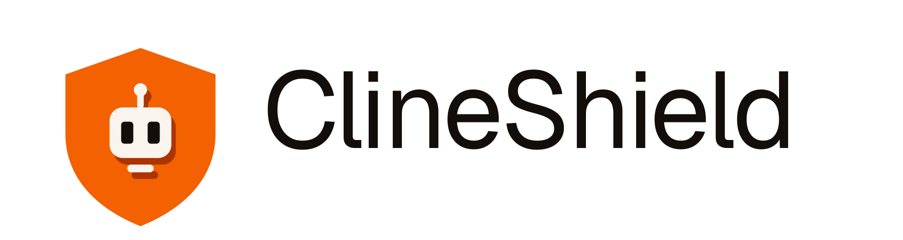
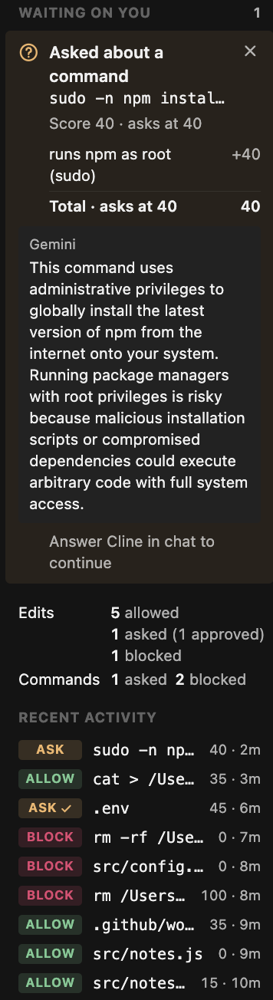

<p align="center">
  
</p>

**A live dashboard for [ClineShield](https://github.com/HansChundekad/ClineShield), the safety plugin for Cline.**
ClineShield scores every action Cline takes before it runs and answers allow, ask or block. This extension shows
what it decided, as it happens.

> **You need the ClineShield plugin first.** The plugin does all the guarding; this extension only displays its log.
> Install it with:
>
> ```sh
> cline plugin install https://github.com/HansChundekad/ClineShield
> ```
>
> The plugin runs in the Cline CLI, SDK and Kanban, not in Cline inside VS Code. Details in the
> [main README](https://github.com/HansChundekad/ClineShield#install).

<!-- SCREENSHOT PLACEHOLDER: uncomment once assets/screenshots/sidebar.png is on main
<p align="center"></p>
-->

## What it shows

Open the **ClineShield** view in the activity bar:

- **Waiting on you:** asks you haven't answered and the latest block, with every category, its points, the total
  and the cut-off. The status bar shows how many are waiting.
- **Totals** and **Recent activity** (last 15 actions): asks you approved ✓ or declined ✗.
- **Settings:** your preset, mode and config file (`~/.cline-shield.yml`), with Open config / Create config.
- **Change map:** every file Cline touched, coloured by its worst risk; files with a blocked attempt are marked.

## Explanations (opt-in)

Run **ClineShield: Set Gemini API Key**, then click **Explain** on an action for a plain-English explanation from
Gemini. Nothing is sent until you click. The key is kept in VS Code's secret storage, never in a file, and secrets
are stripped from code before it is sent. **ClineShield: Clear Gemini API Key** turns it off. Everything else works
without a key.

## Works in

VS Code and its forks (Cursor, Windsurf, VSCodium…). It reads `.cline-shield/metrics.json` in your open folder and
sends nothing anywhere unless you click Explain.

## More

How scoring works, every config key and the evaluation results:
[github.com/HansChundekad/ClineShield](https://github.com/HansChundekad/ClineShield).

MIT © 2026 Hans Chundekad. ClineShield is an independent project, not affiliated with or endorsed by Cline.
